# TWIQO — Architecture, ERD, Plan and Risks

> Design direction: **Mockup set A** (`docs/mockups/*.png`, source `docs/mockups/index.html`).
> Tagline: *Connect. Discover. Move.* Palette: Blue `#246BFD`, Teal `#13B9B0`, Navy `#14213D`, Cloud `#F5F8FF`, Amber `#F5A623`. Font: Plus Jakarta Sans.

## 1. Starting point

The repository was empty (greenfield). Nothing to preserve. Environment used for development: Node 22, PostgreSQL 16 + PostGIS 3.4.

## 2. System architecture

**Modular monolith**, one deployable API, one SPA, clear domain boundaries so a domain can be split out later.

```
 ┌────────────── apps/web (React + TS + Vite SPA) ──────────────┐
 │ Home · Market · Create · Move · Profile · Chat · Admin      │
 └───────────────▲──────────────────────────────────────────────┘
                 │ REST/JSON (+ SSE for realtime)
 ┌───────────────┴──────── apps/api (Node 22, Express, TS) ─────┐
 │ identity  users  social-graph  content  feed  marketplace    │
 │ transport  communities  messaging  offers  bookings          │
 │ payments*  reviews  notifications  search  moderation        │
 │ admin  analytics*                                            │
 │  each module: routes → service → repository (SQL)            │
 │  shared: config, db, auth, validation (zod), errors, audit   │
 └───────────────┬───────────────────────┬──────────────────────┘
                 │                       │
        PostgreSQL 16 + PostGIS    Object storage / CDN*  Payment provider*  Email/Push*
        (pg_trgm, FTS, citext)     (integration boundary) (integration boundary)
 * = integration boundary defined behind an interface; no credentials in repo
```

### Key decisions

| Topic | Decision | Why |
|---|---|---|
| Backend | Express + TypeScript, zod validation, node-postgres with hand-written SQL | Transparent SQL for geospatial/locking; no ORM hiding transactions |
| Migrations | Ordered `.sql` files + small runner (`schema_migrations`) | Reviewable, PostGIS-friendly |
| Auth | Email+password (scrypt), short-lived JWT access token + rotating refresh token (hashed in DB), RBAC | No native deps; revocable sessions |
| Realtime | Server-Sent Events for chat/notifications (WebSocket-ready seam) | Simple, proxy-friendly; fan-out behind an interface so Redis pub/sub can replace the in-process hub |
| Search | PostgreSQL FTS (`tsvector`) + `pg_trgm` + PostGIS radius | Enough until scale; `SearchProvider` interface for later OpenSearch |
| Feed | Unified `feed_items` reference layer + configurable ranking (SQL score) | Social posts are never the source of truth for price/inventory/status |
| Media | `media_assets` + `StorageProvider` interface (local disk dev, S3-compatible prod), derived variants + video jobs | Never serve originals; transcoding via background jobs |
| Background jobs | `jobs` table with `SKIP LOCKED` worker (pg-boss-like), Redis later | Zero extra infra in phase 1 |
| Money | Integer cents + currency; fees from `fee_rules` (admin-configurable); all money writes in DB transactions | No floats, no hardcoded commission |
| Config | Env vars (`.env.example`) for secrets; `platform_settings` table for business config | Admin-editable policies |
| Frontend | React 18, Vite, React Router, TanStack Query, CSS variables from the brand palette | Mobile-first, matches mockups A |

### Module responsibilities and ownership

- **identity** – registration, login, sessions, password reset hooks, roles/permissions, suspension & appeals.
- **users** – profiles, privacy settings, location privacy (stored coarse geometry only).
- **business** – business accounts, members & roles, storefront.
- **social-graph** – follow, block, mute.
- **content** – posts, polls, comments (threaded), reactions, shares, saves, reports (all via the *interaction* layer keyed by `(target_type, target_id)`).
- **media** – assets, variants, upload validation.
- **feed** – `feed_items` fan-in, tabs (For You / Following / Nearby / Circles), cursor pagination, ranking config.
- **marketplace** – categories (admin-managed tree), listings, inventory, attributes, restricted-item policy.
- **transport** – requests, journeys, services, capacity, matching engine.
- **communities (Circles)** – groups, membership, roles, rules, group posts referencing structured objects.
- **offers** – single offer engine for goods *and* transport (`offers` with `subject_type`), offer history, expiry.
- **bookings** – transport bookings, PIN handshakes, delivery events, completion.
- **orders/payments** – product orders, payments, payouts, refunds, disputes (provider-backed).
- **messaging** – conversations, messages, structured cards (offer/booking) kept separate from chat text.
- **reviews**, **notifications**, **search**, **moderation**, **admin**, **analytics**.

### Unified content architecture

```
feed_items (id, item_type, item_id, author_id, group_id?, visibility, geo, created_at, rank_hint)
   item_type ∈ post | listing | transport_request | journey | transport_service | event | promotion
interactions (reactions/comments/saves/shares/reports) → (target_type, target_id)
posts.attachment_type / attachment_id → references structured object (listing, request, journey…)
```

Authoritative data stays in the domain table: price/inventory in `listings`, status in `bookings`, etc. A post that "shares a listing" only stores a reference, so price changes show everywhere instantly.

### Safety by construction
- Server-side authorization on every route (role + ownership + block checks).
- Public APIs only return *coarse* locations (city/FSA-level point jittered into a grid cell); exact pickup addresses live in `booking_addresses`, visible only to booking parties after agreement.
- Moderation actions (`moderation_actions`) operate on `(target_type, target_id)` so removal works on every surface.
- Every admin mutation writes `audit_logs` in the same transaction.
- Rate limits per IP/user on auth, posting, messaging, offers.
- Overselling/double booking prevented by `SELECT … FOR UPDATE` on inventory/capacity rows plus CHECK constraints.

## 3. ERD

```mermaid
erDiagram
  users ||--|| user_profiles : has
  users ||--o{ sessions : has
  users ||--o{ user_roles : has
  roles ||--o{ role_permissions : grants
  users ||--o{ follows : follower
  users ||--o{ blocks : blocker
  users ||--o{ business_members : joins
  businesses ||--o{ business_members : has
  users ||--o{ media_assets : uploads
  users ||--o{ posts : writes
  posts ||--o{ post_media : has
  media_assets ||--o{ post_media : used_in
  users ||--o{ stories : posts
  stories ||--o{ story_views : viewed_by
  posts ||--o{ comments : has
  comments ||--o{ comments : replies
  users ||--o{ reactions : makes
  users ||--o{ saved_items : saves
  users ||--o{ reports : files
  reports ||--o{ moderation_actions : resolved_by
  categories ||--o{ categories : parent
  categories ||--o{ listings : classifies
  users ||--o{ listings : sells
  businesses ||--o{ listings : sells
  listings ||--o{ listing_media : has
  users ||--o{ transport_requests : posts
  users ||--o{ journeys : posts
  users ||--o{ transport_services : offers
  journeys ||--|| transport_capacity : declares
  transport_requests ||--o{ transport_matches : matched
  journeys ||--o{ transport_matches : matched
  offers }o--|| users : buyer
  offers }o--|| users : seller
  offers ||--o{ offer_events : history
  offers ||--o| orders : accepted_into
  offers ||--o| bookings : accepted_into
  bookings ||--o{ delivery_events : tracks
  bookings ||--|| booking_addresses : private
  bookings ||--o{ payments : paid_by
  orders ||--o{ payments : paid_by
  payments ||--o{ refunds : refunded_by
  bookings ||--o{ reviews : reviewed
  orders ||--o{ reviews : reviewed
  bookings ||--o{ disputes : disputed
  groups ||--o{ group_members : has
  users ||--o{ group_members : joins
  groups ||--o{ group_posts : contains
  groups ||--o{ events : hosts
  conversations ||--o{ conversation_members : has
  conversations ||--o{ messages : has
  users ||--o{ notifications : receives
  promotions ||--o{ sponsored_placements : buys
  fee_rules }o--|| platform_settings : configured_by
  users ||--o{ audit_logs : actor
  feed_items }o--|| posts : refs
  feed_items }o--|| listings : refs
  feed_items }o--|| journeys : refs
  feed_items }o--|| transport_requests : refs
```



### Key constraints, indexes and lifecycles

| Entity | Constraints / indexes | Lifecycle |
|---|---|---|
| users | unique `citext` email & username; `status` CHECK | pending → active → suspended → banned/deleted |
| follows / blocks | PK `(follower_id, followee_id)`; CHECK not self | — |
| listings | GiST on `location`; GIN on `search_vector`; btree `(category_id, status, created_at)`; `price_cents >= 0`; `quantity >= 0` CHECK (decremented under row lock when orders arrive in phase 4) | draft → active → reserved → sold / expired / removed |
| journeys | GiST on `origin`, `destination`; `departure_at`; capacity CHECKs | draft → open → full → departed → completed / cancelled |
| transport_requests | GiST origin/destination; `status` | open → matched → booked → completed / cancelled / expired |
| offers | partial unique index: one *accepted* offer per subject; `expires_at` | pending → countered → accepted / rejected / withdrawn / expired |
| bookings | unique `(journey_id, request_id)` active; capacity reserved in tx | confirmed → pickup_confirmed → in_transit → delivered → completed / cancelled / disputed |
| payments | idempotency key unique; amounts in cents | requires_action → authorized → captured → refunded / failed |
| feed_items | unique `(item_type, item_id)`; `(created_at, id)` cursor index; GiST geo | mirrors source lifecycle |
| reactions | unique `(user_id, target_type, target_id, kind)` | — |
| audit_logs | append-only; indexed `(actor_id, created_at)` | immutable |

## 4. Dependencies and external integrations

| Need | Phase-1 choice | Production integration (boundary exists) | Needs from you |
|---|---|---|---|
| Database | PostgreSQL 16 + PostGIS | Managed Postgres (RDS/Cloud SQL/Supabase) | Hosting decision |
| Object storage + CDN | Local disk | S3-compatible + CDN | Bucket + credentials |
| Video | Upload + poster only | FFmpeg workers (HLS ladder) or managed (Mux/Cloudflare Stream) | Provider choice |
| Payments | Interface + fake provider for tests only | Stripe Connect (Canada) — verify marketplace/KYC terms, destination charges, payout schedule | Stripe account, legal review |
| Identity verification | Admin-reviewed manual flow | Stripe Identity / Persona / Onfido | Provider choice |
| Email/SMS/Push | Console logger | Postmark/SES, Twilio, FCM/APNs | Credentials |
| Maps/geocoding | PostGIS distance only, postal-code → point via lookup table | Mapbox / Google Places / Canada Post | API key |
| Moderation AI | Banned-words + rules | Optional image/video classifier | Provider choice |

> We do **not** claim escrow, insurance or tracking that is not actually provided. UI copy states that insurance depends on the transporter's own coverage; funds-holding language is used only if the provider/legal setup supports it.

## 5. Phased plan

| Phase | Scope | Status |
|---|---|---|
| 1 Foundation | Auth, profiles, business profiles, navigation, feed, posts/photos, listings, search, follow, likes/comments, basic messaging, admin foundations | **Done** |
| 2 Transport | Requests, journeys, services, matching, negotiation (offers), booking, transporter profiles, reviews | Planned |
| 3 Communities & video | Circles + permissions, Clips, Stories, media processing | **Done** |
| 4 Transactions & money | Payments, commissions, payouts, premium listings, promotions, PIN confirmations, disputes, advanced admin | Planned |
| 5 Growth | Recommendations, trending, subscriptions, referrals, analytics, perf, i18n/international | Planned |

The schema in `apps/api/migrations` is written so later phases add tables and modules rather than rewrite the foundation (offers, feed_items, interactions and moderation are polymorphic from day one).

## 6. Risks

**Technical** – Feed ranking cost at scale (mitigate: cursor pagination, precomputed `rank_hint`, caching later); video transcoding cost; geospatial query load (GiST indexes, bounding-box prefilter); realtime fan-out beyond one node (hub interface → Redis); polymorphic references lack FK integrity (mitigate: validation in service + periodic integrity job).

**Operational** – Moderation staffing; support for disputes; abuse of free listings; cold-start liquidity (needs seeded groups/journeys in launch cities).

**Legal / compliance (Canada)** – Marketplace prohibited/restricted items (firearms, cannabis, vapes, alcohol, wildlife, recalled goods) policy per province; PIPEDA and Quebec Law 25 privacy obligations; CASL for email/SMS; payments regulation & provider KYC; independent-contractor classification of transporters; liability/insurance wording; provincial sales tax on commissions; accessibility (AODA); CIPO trademark clearance for "TWIQO" (not yet cleared).

**Security / fraud** – Account takeover (rate limits, session revocation, optional 2FA later), fake listings/off-platform payment scams (message scanning signals, new-account limits), PIN brute force (attempt limits + lockout), location leakage (coarse public geometry), upload malware/abuse (type/size validation, re-encoding), IDOR (ownership checks + tests), double-spend/oversell (row locks + tests).

## 7. Phase 2 design notes

**Matching.** A journey stores its route as a PostGIS `LineString` through its stops. For a shipment, the engine measures how far the pickup and drop-off are from that line (`ST_Distance`), whether the driver passes the pickup *before* the drop-off (`ST_LineLocatePoint`), and what share of the requested leg the route covers. Hard rules exclude (capacity, size, restrictions, wrong direction, dates, too far). The rest is a 0–100 score with human-readable reasons and warnings; near misses are kept as *partial* matches so people can negotiate a detour. The scorer is a pure function covered by unit tests.

**One offer engine.** `offers` serves goods and transport. `customer` is the buyer/shipper and `provider` the seller/transporter; each negotiation step is a new row pointing at its parent, so the full history is preserved and any version can be accepted exactly once. Accepting creates an `order` (goods) or a `booking` (transport) in the same transaction.

**Concurrency.** Locks are always taken in the order shared subject (listing or shipment) → offer → carrier (journey or service), with non-key locks so unrelated foreign-key inserts never block. Concurrent accepts therefore serialise instead of deadlocking (a real deadlock found by the test suite and fixed). A partial unique index allows only one live booking per shipment, and `CHECK` constraints stop capacity going negative.

**Privacy.** Public objects expose city-level places only. Exact addresses live in `booking_addresses`. Pickup and delivery PINs are shown to the shipper and entered by the transporter; failures are recorded outside the request transaction so lockouts cannot be rolled back.

## 8. Phase 3 design notes

**Video behind an interface.** `VideoProvider` (`createUpload`, `refresh`, `urls`, `remove`) is the only thing the app knows about video. `LocalVideoProvider` streams the upload to disk and runs FFmpeg (720p H.264/AAC, faststart, poster frame). `BunnyVideoProvider` creates the video through Bunny's API and hands the browser a signed TUS upload, so large files never pass through our servers and the API key never reaches the client. Each `videos` row remembers its provider, so providers can be switched without breaking old videos. The webhook never trusts its payload; it re-reads the real status from the provider.

**Posts wait for their video.** A clip is created immediately but is kept out of every feed until its video is `ready`; if processing fails the post is removed. Circle posts in private circles carry `visibility = 'group'`, so one `visibleTo` rule hides them from everyone but active members, and re-labelling happens when a circle changes visibility.

**Circles.** Roles are ranks; every action checks rank, never just membership. A partial unique index guarantees one owner. Private circles return 404 to outsiders (no existence leak). Moderator removals write both `moderation_actions` (with the reason) and the audit log.

**A lesson worth recording.** Zod 4 keeps `.default()` values inside `.partial()`, so PATCH endpoints built from create schemas silently reset untouched fields (it would have wiped listing photos and made private requests public). All update endpoints now use `patchOf()` and regression tests pin the behaviour.


## 9. Phase 4 design notes (payments)

**Money flow.** Destination charges: `PaymentIntent{amount, application_fee_amount, transfer_data.destination}` on the platform account. The payee's share moves to their Express account immediately; twiqo keeps the application fee. Boosts are plain platform charges (no transfer). Refunds use `reverse_transfer` (and `refund_application_fee` when `payments.refund_platform_fee` is on) so refunds come out of the payee's balance. Payout delay is set on connected accounts (best effort) so refunds and disputes can be handled before funds leave. This is not escrow: twiqo does not hold funds, and the UI says so.

**Tables** (migration 008): `payment_accounts`, `payments` (one live payment per order/booking/boost via partial unique indexes; fee snapshot columns), `refunds`, `payouts`, `webhook_events` (event id primary key = idempotency), `disputes` + `dispute_messages`, `boosts`; `orders.payment_status` / `bookings.payment_status` are denormalised for views and updated in the same transaction as the payment.

**Consistency rules.**
- Payment row is committed before the provider call; the provider idempotency key is `pay:<payment id>` so a retry never double-charges. If the provider call fails the row is marked failed.
- The success webhook is the only thing that marks a payment paid; the client never asserts success.
- Refund: under `FOR NO KEY UPDATE` on the payment, pending refunds count against the remainder; the provider call uses `refund:<refund id>`; success is applied exactly once.
- Webhook event insert and state change share one transaction; replays return `duplicate`. Side effects that call the provider (late-payment refunds) run after commit.
- A payment arriving for an already-cancelled order/booking/boost is refunded automatically.

**Disputes** are a staff review process (not insurance and not a card chargeback). Open disputes block manual and automatic completion and new checkout. Stripe card disputes (`charge.dispute.created`) are recorded for staff; evidence submission is not built.

**Risks / open items.** Adapter unverified against live Stripe; sales tax and marketplace-facilitator obligations; KYC/identity handled by Stripe Express only; fee changes apply to new payments only; revenue report is derived from webhooks and must be reconciled with Stripe.


## 10. Phase 5 design notes (growth)

**Discovery.** Trending and recommendations are SQL over signals that already exist (reactions, saves, offers, follows) plus `analytics_events` views. Trending is cached per process for 60 s (swap for Redis when there is more than one API node). Recommendation scoring: category/tag affinity from the person's own saves/likes/offers + proximity + recency; blocked users and already-seen items are excluded in SQL.

**For You feed.** Ranking cost was O(all feed items). It now scores a candidate pool: 600 newest, 300 newest from followed accounts, 300 nearest (KNN on the GiST index). Trade-off: For You paging ends after the pool (~1,200 items); Following/Nearby/Circles page by keyset without a cap.

**Credit ledger.** `credit_ledger` is append-only (trigger). Balance = SUM. Spending locks the `users` row, checks the balance, then inserts, so concurrent boosts can't spend the same credit (tested). A referral reward is unique per referral (partial unique index). Credit only pays a boost in full, which avoids split-tender refund cases.

**Referral qualification** runs inside the same transaction that completes an order or booking, for both parties. Rules: referral still `signed_up`, counterparty is not the referrer, deal >= minimum, reward cap not exceeded.

**Subscriptions.** `subscriptions` is one row per user, updated only by provider events (never by the client). A late `active` event after `canceled` for the same subscription id is ignored. Entitlement = active, or past_due for up to 3 days after period end. The commission discount is applied when a payment is created and recorded in the payment's fee snapshot.

**Analytics.** Event names are an allow-list in the database; the browser can only send `view`, `search`, `share`, `contact_click` (server-only events can't be forged). Views are de-duplicated per person per target per 30 min. Funnel numbers are computed from real tables, not events.

**i18n.** Dictionary-based `t()` with English fallback; the language is stored in `localStorage` and `users.locale`. Changing language remounts the UI tree (simple and correct, loses unsaved form input).

**Risks / open items.** Referral abuse; analytics volume on a single Postgres table (add partitioning or a warehouse export when it grows past tens of millions of rows); privacy policy wording; French quality.


## 11. Phase 6 design notes

**Job queue.** `jobs` table; workers claim with `FOR UPDATE SKIP LOCKED`, retry with exponential backoff (30 s doubling to 1 h), give up after `max_attempts` (visible in Admin → System as dead jobs). Housekeeping is itself a self-rescheduling job with a dedupe key, so only one node runs it. Emails and notifications are enqueued inside the transaction that caused them and are delivered after it commits.

**Sessions.** Access tokens carry a session id; every request checks the session is not revoked, so remote sign-out, password change and suspension take effect immediately instead of when the 15-minute token expires.

**Secrets at rest.** TOTP seeds are AES-256-GCM encrypted with a key derived from `JWT_SECRET` (rotating it forces 2FA re-enrolment). Recovery codes and email/reset tokens are stored hashed. Private driver documents live outside the public `/media` tree, are re-encoded (stripping EXIF), and are served only to the owner and reviewers with an audit entry.

**Risk model.** Additive scores from named rules; a listing is held at `risk.flag_threshold`; every flag records its reasons for the reviewer. Nothing is deleted automatically. Chat warnings are shown only to the receiver so senders can't tune their wording against the rules.

**Blind reviews.** `reviews.revealed_at` gates every read (profiles, aggregates, ranking, booking views). Both reviews reveal when the second arrives; housekeeping reveals a lone review after `reviews.reveal_after_days`.

**Instant book.** Reuses the normal accept path (`acceptOffer`) with the driver as actor, so capacity checks, locking order and notifications are identical; any failure falls back to a normal pending offer.

**Safety data.** Trip links are random 144-bit tokens with 3-day expiry and a public view limited to route, status, first name and last known location. Location points are only stored with the driver's per-booking consent, capped at 200, deleted when sharing stops and two days after a booking ends.

**Operations.** Request id on every response and log line; query strings are never logged (the realtime stream carries a token there). `/ready` fails when the database is down or the oldest due job is over 10 minutes late. The authorization sweep walks the registered routes: any new write route without a sign-in guard, or admin route open to members, fails the test suite.

**Known limits.** Saved-search matching scans up to 5,000 searches per new item (fine for tens of thousands of users; index or move to a search service after that). Analytics and jobs share the primary database. The in-process cache is per node. The Docker files and CSP header are untested in a browser.
