# TWIQO — Architecture, ERD, Plan and Risks

> Design direction: **Mockup set A** (`docs/mockups/*.png`, source `docs/mockups/index.html`).
> Tagline: *Connect. Discover. Move.* Palette: Blue `#246BFD`, Teal `#13B9B0`, Navy `#14213D`, Cloud `#F5F8FF`, Amber `#F5A623`. Font: Plus Jakarta Sans.

## 1. Starting point

The repository was empty (greenfield). Nothing to preserve. Environment used for development: Node 22, PostgreSQL 16 + PostGIS 3.4.

## 2. System architecture

**Modular monolith**, one deployable API, one SPA, clear domain boundaries so a domain can be split out later.

```
 ┌────────────── apps/web (React + TS + Vite SPA) ──────────────┐
 │ Home · Market · Create · Move · Profile · Chat · Admin      │
 └───────────────▲──────────────────────────────────────────────┘
                 │ REST/JSON (+ SSE for realtime)
 ┌───────────────┴──────── apps/api (Node 22, Express, TS) ─────┐
 │ identity  users  social-graph  content  feed  marketplace    │
 │ transport  communities  messaging  offers  bookings          │
 │ payments*  reviews  notifications  search  moderation        │
 │ admin  analytics*                                            │
 │  each module: routes → service → repository (SQL)            │
 │  shared: config, db, auth, validation (zod), errors, audit   │
 └───────────────┬───────────────────────┬──────────────────────┘
                 │                       │
        PostgreSQL 16 + PostGIS    Object storage / CDN*  Payment provider*  Email/Push*
        (pg_trgm, FTS, citext)     (integration boundary) (integration boundary)
 * = integration boundary defined behind an interface; no credentials in repo
```

### Key decisions

| Topic | Decision | Why |
|---|---|---|
| Backend | Express + TypeScript, zod validation, node-postgres with hand-written SQL | Transparent SQL for geospatial/locking; no ORM hiding transactions |
| Migrations | Ordered `.sql` files + small runner (`schema_migrations`) | Reviewable, PostGIS-friendly |
| Auth | Email+password (scrypt), short-lived JWT access token + rotating refresh token (hashed in DB), RBAC | No native deps; revocable sessions |
| Realtime | Server-Sent Events for chat/notifications (WebSocket-ready seam) | Simple, proxy-friendly; fan-out behind an interface so Redis pub/sub can replace the in-process hub |
| Search | PostgreSQL FTS (`tsvector`) + `pg_trgm` + PostGIS radius | Enough until scale; `SearchProvider` interface for later OpenSearch |
| Feed | Unified `feed_items` reference layer + configurable ranking (SQL score) | Social posts are never the source of truth for price/inventory/status |
| Media | `media_assets` + `StorageProvider` interface (local disk dev, S3-compatible prod), derived variants + video jobs | Never serve originals; transcoding via background jobs |
| Background jobs | `jobs` table with `SKIP LOCKED` worker (pg-boss-like), Redis later | Zero extra infra in phase 1 |
| Money | Integer cents + currency; fees from `fee_rules` (admin-configurable); all money writes in DB transactions | No floats, no hardcoded commission |
| Config | Env vars (`.env.example`) for secrets; `platform_settings` table for business config | Admin-editable policies |
| Frontend | React 18, Vite, React Router, TanStack Query, CSS variables from the brand palette | Mobile-first, matches mockups A |

### Module responsibilities and ownership

- **identity** – registration, login, sessions, password reset hooks, roles/permissions, suspension & appeals.
- **users** – profiles, privacy settings, location privacy (stored coarse geometry only).
- **business** – business accounts, members & roles, storefront.
- **social-graph** – follow, block, mute.
- **content** – posts, polls, comments (threaded), reactions, shares, saves, reports (all via the *interaction* layer keyed by `(target_type, target_id)`).
- **media** – assets, variants, upload validation.
- **feed** – `feed_items` fan-in, tabs (For You / Following / Nearby / Circles), cursor pagination, ranking config.
- **marketplace** – categories (admin-managed tree), listings, inventory, attributes, restricted-item policy.
- **transport** – requests, journeys, services, capacity, matching engine.
- **communities (Circles)** – groups, membership, roles, rules, group posts referencing structured objects.
- **offers** – single offer engine for goods *and* transport (`offers` with `subject_type`), offer history, expiry.
- **bookings** – transport bookings, PIN handshakes, delivery events, completion.
- **orders/payments** – product orders, payments, payouts, refunds, disputes (provider-backed).
- **messaging** – conversations, messages, structured cards (offer/booking) kept separate from chat text.
- **reviews**, **notifications**, **search**, **moderation**, **admin**, **analytics**.

### Unified content architecture

```
feed_items (id, item_type, item_id, author_id, group_id?, visibility, geo, created_at, rank_hint)
   item_type ∈ post | listing | transport_request | journey | transport_service | event | promotion
interactions (reactions/comments/saves/shares/reports) → (target_type, target_id)
posts.attachment_type / attachment_id → references structured object (listing, request, journey…)
```

Authoritative data stays in the domain table: price/inventory in `listings`, status in `bookings`, etc. A post that "shares a listing" only stores a reference, so price changes show everywhere instantly.

### Safety by construction
- Server-side authorization on every route (role + ownership + block checks).
- Public APIs only return *coarse* locations (city/FSA-level point jittered into a grid cell); exact pickup addresses live in `booking_addresses`, visible only to booking parties after agreement.
- Moderation actions (`moderation_actions`) operate on `(target_type, target_id)` so removal works on every surface.
- Every admin mutation writes `audit_logs` in the same transaction.
- Rate limits per IP/user on auth, posting, messaging, offers.
- Overselling/double booking prevented by `SELECT … FOR UPDATE` on inventory/capacity rows plus CHECK constraints.

## 3. ERD

```mermaid
erDiagram
  users ||--|| user_profiles : has
  users ||--o{ sessions : has
  users ||--o{ user_roles : has
  roles ||--o{ role_permissions : grants
  users ||--o{ follows : follower
  users ||--o{ blocks : blocker
  users ||--o{ business_members : joins
  businesses ||--o{ business_members : has
  users ||--o{ media_assets : uploads
  users ||--o{ posts : writes
  posts ||--o{ post_media : has
  media_assets ||--o{ post_media : used_in
  users ||--o{ stories : posts
  stories ||--o{ story_views : viewed_by
  posts ||--o{ comments : has
  comments ||--o{ comments : replies
  users ||--o{ reactions : makes
  users ||--o{ saved_items : saves
  users ||--o{ reports : files
  reports ||--o{ moderation_actions : resolved_by
  categories ||--o{ categories : parent
  categories ||--o{ listings : classifies
  users ||--o{ listings : sells
  businesses ||--o{ listings : sells
  listings ||--o{ listing_media : has
  users ||--o{ transport_requests : posts
  users ||--o{ journeys : posts
  users ||--o{ transport_services : offers
  journeys ||--|| transport_capacity : declares
  transport_requests ||--o{ transport_matches : matched
  journeys ||--o{ transport_matches : matched
  offers }o--|| users : buyer
  offers }o--|| users : seller
  offers ||--o{ offer_events : history
  offers ||--o| orders : accepted_into
  offers ||--o| bookings : accepted_into
  bookings ||--o{ delivery_events : tracks
  bookings ||--|| booking_addresses : private
  bookings ||--o{ payments : paid_by
  orders ||--o{ payments : paid_by
  payments ||--o{ refunds : refunded_by
  bookings ||--o{ reviews : reviewed
  orders ||--o{ reviews : reviewed
  bookings ||--o{ disputes : disputed
  groups ||--o{ group_members : has
  users ||--o{ group_members : joins
  groups ||--o{ group_posts : contains
  groups ||--o{ events : hosts
  conversations ||--o{ conversation_members : has
  conversations ||--o{ messages : has
  users ||--o{ notifications : receives
  promotions ||--o{ sponsored_placements : buys
  fee_rules }o--|| platform_settings : configured_by
  users ||--o{ audit_logs : actor
  feed_items }o--|| posts : refs
  feed_items }o--|| listings : refs
  feed_items }o--|| journeys : refs
  feed_items }o--|| transport_requests : refs
```



### Key constraints, indexes and lifecycles

| Entity | Constraints / indexes | Lifecycle |
|---|---|---|
| users | unique `citext` email & username; `status` CHECK | pending → active → suspended → banned/deleted |
| follows / blocks | PK `(follower_id, followee_id)`; CHECK not self | — |
| listings | GiST on `location`; GIN on `search_vector`; btree `(category_id, status, created_at)`; `price_cents >= 0`; `quantity >= 0` CHECK (decremented under row lock when orders arrive in phase 4) | draft → active → reserved → sold / expired / removed |
| journeys | GiST on `origin`, `destination`; `departure_at`; capacity CHECKs | draft → open → full → departed → completed / cancelled |
| transport_requests | GiST origin/destination; `status` | open → matched → booked → completed / cancelled / expired |
| offers | partial unique index: one *accepted* offer per subject; `expires_at` | pending → countered → accepted / rejected / withdrawn / expired |
| bookings | unique `(journey_id, request_id)` active; capacity reserved in tx | confirmed → pickup_confirmed → in_transit → delivered → completed / cancelled / disputed |
| payments | idempotency key unique; amounts in cents | requires_action → authorized → captured → refunded / failed |
| feed_items | unique `(item_type, item_id)`; `(created_at, id)` cursor index; GiST geo | mirrors source lifecycle |
| reactions | unique `(user_id, target_type, target_id, kind)` | — |
| audit_logs | append-only; indexed `(actor_id, created_at)` | immutable |

## 4. Dependencies and external integrations

| Need | Phase-1 choice | Production integration (boundary exists) | Needs from you |
|---|---|---|---|
| Database | PostgreSQL 16 + PostGIS | Managed Postgres (RDS/Cloud SQL/Supabase) | Hosting decision |
| Object storage + CDN | Local disk | S3-compatible + CDN | Bucket + credentials |
| Video | Upload + poster only | FFmpeg workers (HLS ladder) or managed (Mux/Cloudflare Stream) | Provider choice |
| Payments | Interface + fake provider for tests only | Stripe Connect (Canada) — verify marketplace/KYC terms, destination charges, payout schedule | Stripe account, legal review |
| Identity verification | Admin-reviewed manual flow | Stripe Identity / Persona / Onfido | Provider choice |
| Email/SMS/Push | Console logger | Postmark/SES, Twilio, FCM/APNs | Credentials |
| Maps/geocoding | PostGIS distance only, postal-code → point via lookup table | Mapbox / Google Places / Canada Post | API key |
| Moderation AI | Banned-words + rules | Optional image/video classifier | Provider choice |

> We do **not** claim escrow, insurance or tracking that is not actually provided. UI copy states that insurance depends on the transporter's own coverage; funds-holding language is used only if the provider/legal setup supports it.

## 5. Phased plan

| Phase | Scope | Status |
|---|---|---|
| 1 Foundation | Auth, profiles, business profiles, navigation, feed, posts/photos, listings, search, follow, likes/comments, basic messaging, admin foundations | **In progress** |
| 2 Transport | Requests, journeys, services, matching, negotiation (offers), booking, transporter profiles, reviews | Planned |
| 3 Communities & video | Circles + permissions, Clips, Stories, media processing | Planned |
| 4 Transactions & money | Payments, commissions, payouts, premium listings, promotions, PIN confirmations, disputes, advanced admin | Planned |
| 5 Growth | Recommendations, trending, subscriptions, referrals, analytics, perf, i18n/international | Planned |

The schema in `apps/api/migrations` is written so later phases add tables and modules rather than rewrite the foundation (offers, feed_items, interactions and moderation are polymorphic from day one).

## 6. Risks

**Technical** – Feed ranking cost at scale (mitigate: cursor pagination, precomputed `rank_hint`, caching later); video transcoding cost; geospatial query load (GiST indexes, bounding-box prefilter); realtime fan-out beyond one node (hub interface → Redis); polymorphic references lack FK integrity (mitigate: validation in service + periodic integrity job).

**Operational** – Moderation staffing; support for disputes; abuse of free listings; cold-start liquidity (needs seeded groups/journeys in launch cities).

**Legal / compliance (Canada)** – Marketplace prohibited/restricted items (firearms, cannabis, vapes, alcohol, wildlife, recalled goods) policy per province; PIPEDA and Quebec Law 25 privacy obligations; CASL for email/SMS; payments regulation & provider KYC; independent-contractor classification of transporters; liability/insurance wording; provincial sales tax on commissions; accessibility (AODA); CIPO trademark clearance for "TWIQO" (not yet cleared).

**Security / fraud** – Account takeover (rate limits, session revocation, optional 2FA later), fake listings/off-platform payment scams (message scanning signals, new-account limits), PIN brute force (attempt limits + lockout), location leakage (coarse public geometry), upload malware/abuse (type/size validation, re-encoding), IDOR (ownership checks + tests), double-spend/oversell (row locks + tests).
